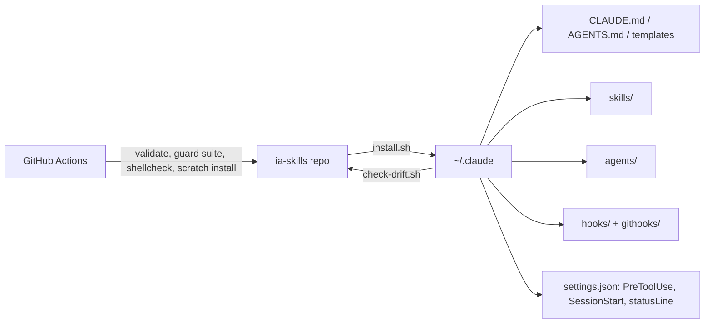

# 🧠 AI Workspace

The source of truth for an agentic development setup on Claude Code: global rules, skills, subagents, safety hooks, the status line, and the reference material for building MCP servers, LLM apps and evals. One installer restores all of it onto a machine.

**Stack:** Claude Code · Bash · Python 3 · jq · GitHub Actions

## 🗺️ What's inside, by layer

| Layer | What | Where |
| --- | --- | --- |
| 01 Context | Global rules, architecture reference, PRD and repo templates | `skills/bootstrap-workspace/assets/`, `skills/prd-first/assets/`, `skills/architecture-baseline/assets/` |
| 02 Skills | 27 skills: commands, governance, domain and AI engineering references | `skills/` |
| 03 MCP | How to build servers agents can use | `mcp-server` skill |
| 04 Subagents | Researcher, implementer, verifier, security reviewer, docs writer | `agents/` |
| 05 Hooks | Bash guard, session resume, git hooks | `skills/guardrails/assets/`, `skills/context-protocol/assets/` |
| 06 Pipelines | PRD → plan gate → research → implement → verify | `prd-first`, `plan-gate`, `agent-pipeline` |
| 07 CI | This repo validates itself on every PR | `.github/workflows/validate.yml` |
| 08 API & Agent SDK | Rules for features and agents on Claude | `llm-apps` skill |
| 09 Evals | Golden sets, judges, CI regressions, skill trigger evals | `llm-evals` skill |

## 🚀 Quick Start

```bash
git clone https://github.com/krealalejo/ia-skills.git
cd ia-skills
skills/bootstrap-workspace/assets/install.sh --dry-run
skills/bootstrap-workspace/assets/install.sh
```

Restart Claude Code afterwards. The installer backs up every file it replaces, is idempotent, and ends by running the guard test suite. Add `--git-hooks` to also install the global git hooks (a machine-wide `core.hooksPath` change).

Only want the skills? `npx skills add krealalejo/ia-skills` installs them through [skills.sh](https://www.skills.sh), without agents, hooks or rules.

## 🧰 Commands

| Command | What it does |
| --- | --- |
| `skills/bootstrap-workspace/assets/install.sh [--dry-run] [--git-hooks]` | Restore the whole workspace into `~/.claude` (or `$CLAUDE_CONFIG_DIR`) |
| `scripts/check-drift.sh` | List what differs between `~/.claude` and this repo; exits 1 on drift |
| `python3 scripts/validate-skills.py` | Check every skill and agent: frontmatter, sections, listed in the docs |
| `GUARD=skills/guardrails/assets/guard-bash.sh python3 skills/guardrails/assets/test/run.py skills/guardrails/assets/test/cases.json` | Run the 38-case Bash guard suite |

## ⚙️ Skills

**Command skills** run on a slash command. **Reference skills** load on their own when the work enters their domain; their one-line description is the router.

### Command skills

| Skill | Trigger | Purpose |
| --- | --- | --- |
| `git-commit` | `/commit [ticket-id]` | Atomic [Conventional Commits](https://www.conventionalcommits.org/), grouped by module, ticket id in the scope, max 300 chars |
| `code-review` | `/review [task]` | Reviews the branch against `main` with inline Problem / Suggestion comments; TypeScript, clean code, SOLID |
| `typescript-review` | `/typescript [file]` | Overloads, generics, type predicates, exhaustiveness with `never`, utility types |
| `release-commit` | `/release-commit` | Empty `summary:` commit describing the whole branch in plain English |
| `playwright-web` | `/playwright-web [url] [flow]` | E2E UI tests: researches `data-test-id` selectors and async anchors first |
| `playwright-api` | `/playwright-api [method] [path]` | E2E API tests with the `request` fixture: 200, 401, 400/422, 404, teardown |
| `add-readme` | `/add-readme [context]` | README from `assets/template.md`: stack, quick start, commands, Mermaid architecture |

### 🧭 Governance skills

| Skill | Loads when | Purpose |
| --- | --- | --- |
| `prd-first` | Any non-trivial task | Mission / In Scope / Out of Scope / Architecture; no code while `status: draft`; nothing outside In Scope gets built |
| `plan-gate` | 3+ files, a dependency, data model, infra, cross-boundary rename | Six-part plan (goal, files, order, risk, rollback, verification) and explicit approval |
| `context-protocol` | Context at 60% | Document & Clear to `docs/sessions/`, then resume; the `SessionStart` hook points the next session at the file |
| `agent-pipeline` | Work too large for one context window | Lead Researcher pattern with the subagents below; parallel reads, serial writes, a fresh verifier |
| `architecture-baseline` | Entering a repo, a design decision | Ten standing decisions, monorepo boundaries, definition of done; `CLAUDE.md` / `AGENTS.md` templates |

### 📚 Domain reference skills

Each ends with a **Red Flags** list of the patterns that should stop a review.

| Skill | Loads when | Focus |
| --- | --- | --- |
| `react` | `.tsx`/`.jsx`, hooks, component tests | State ownership, effects, data fetching, a11y, RTL |
| `vue` | `.vue`, composables, Pinia, Nuxt | `<script setup>`, `ref` over `reactive`, composable cleanup |
| `javascript` | Framework-free `.js`/`.mjs` | ESM, safe DOM, event delegation, `AbortController` |
| `css` | Stylesheets, `<style>`, design tokens | Strict BEM, mobile-first, custom-property theming |
| `serverless-api` | Handlers, endpoints, queue consumers | Thin handlers, edge validation, error mapping, idempotency |
| `php` | Any PHP (+ `symfony.md`) | PHP 8.x strict types, enums, readonly; Symfony DI, routing, Doctrine |
| `postgres` | SQL, schema, indexes, migrations | Indexing, keyset pagination, expand/migrate/contract |
| `aws` | SDK calls, credentials in app code | Never hardcode, least privilege, SDK v3, retries |
| `cloud-infra` | IaC, IAM policies, CI pipelines | Least privilege, environment isolation, deploy safety |

### 🤖 AI engineering skills

| Skill | Loads when | Focus |
| --- | --- | --- |
| `mcp-server` | Building or reviewing an MCP server | Few whole-task tools, Zod inputs, side-effect annotations, actionable errors, stdio vs Streamable HTTP, no token passthrough |
| `llm-apps` | Code on `@anthropic-ai/sdk` or the Claude Agent SDK | Simplest surface first, bounded Tool Runner loops, structured outputs, verified prompt caching, batch, untrusted input, cost logging |
| `llm-evals` | A prompt, model or tool change; a new skill description | Golden datasets, calibrated LLM judges, CI regression slices, cost per run, trigger evals for skills |

`llm-apps` pairs with Claude Code's bundled `claude-api` skill: this repo holds the standing decisions, `claude-api` holds the current models and parameters.

### 🛡️ Setup skills

| Skill | Trigger | Purpose |
| --- | --- | --- |
| `guardrails` | `/guardrails` | Bash guard and global git hooks: destructive deletes, protected branches, force-push without lease, secrets, `curl \| sh`, `DROP`/`TRUNCATE`, deploys, repo-wide scripts. Delegates to each repo's own hooks |
| `bootstrap-workspace` | `/bootstrap-workspace` | The installer and the drift check |
| `statusline` | `/statusline` | Two lines: model and real context size, effort, branch (red on `main`); context bar, 5-hour and 7-day windows, cost |

## 🕸️ Subagents

Isolated contexts with restricted tools, in `agents/`. Read-only roles cannot edit by construction.

| Agent | Tools | Model | Role |
| --- | --- | --- | --- |
| `pipeline-researcher` | Read, Grep, Glob, Bash | sonnet | Answers one closed question, read-only, with `path:line` citations |
| `pipeline-implementer` | Read, Edit, Write, Grep, Glob, Bash | opus | Builds one approved slice of the plan, touching only its files |
| `pipeline-verifier` | Read, Grep, Glob, Bash | opus | Fresh adversarial check against the PRD; reports failures, never edits |
| `security-reviewer` | Read, Grep, Glob, Bash | opus | Injection, access control, secrets, insecure IaC, LLM tool abuse; one exploit scenario per finding |
| `docs-writer` | Read, Edit, Write, Grep, Glob, Bash | sonnet | Brings README, CLAUDE.md and PRD logs in line with the diff; edits markdown only |

## 🔒 Hooks

| Hook | Event | Does |
| --- | --- | --- |
| Bash guard | `PreToolUse` (Bash) | Blocks the commands above before they run. A repo can opt out with `git config --local claude.guardBash false`, and only a human can set that |
| Session resume | `SessionStart` | Tells a new or cleared session that `docs/sessions/<file>.md` exists, so work resumes from it instead of re-exploring |
| Git hooks | `pre-commit`, `pre-push` | Same rules for humans and agents: protected branches, staged secrets, failing tests |

## 🏗️ Architecture



## 📁 Source layout

```
agents/                       subagents
scripts/validate-skills.py    skill and agent validator
scripts/check-drift.sh        ~/.claude vs repo
skills/<name>/SKILL.md        one skill per folder
skills/<name>/assets/         files the skill installs: templates, hooks, scripts
.github/workflows/            CI for this repo
```

## 📦 Dependencies

- **[RTK (AI Agent Tooling)](https://github.com/rtk-ai/rtk)**: used by the git skills to run git commands.
- `bash`, `python3` and `jq` for the installer and hooks.

---

_Developed with ❤️ by krealalejo_
